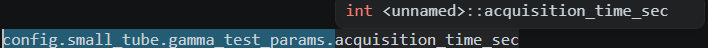

# C Best Practices and Info

- oggetto che ritorna una `struct`
    - Struct piccola/moderata e semplice da copiare → ritorna la struct per valore (e tale valore cessa di esistere fuori dallo scope di funzione del chiamante)
    - Oggetto grande, condiviso, modificabile da più parti o allocato dinamicamente → ritorna un puntatore
    - Mai ritornare il puntatore a una variabile locale (una variabiel che "vive" solo all'interno di una funzione)

- differenza tra `.` (punto) e `->` (freccia) 
    - . quando hai la struct
    - -> quando hai un puntatore alla struct

- struttura dati `union`
    ```c
    union Dato {
        int i;
        float f;
        char c;
    };
    ```
    Con una union i campi i, f e c occupano la stessa memoria.
    La union avrà dimensione sufficiente a contenere il campo più grande (più eventuale padding).

- usa `assert` per precondizioni, postcondizioni e invarianti interne che segnalano errori di programmazione; valida gli input con controlli normali

- i nomi delle variabili e delle funzioni sono in formato `snake_case`

- le struct si mettono nel file .h

- non è necessario creare una cartella models contente le struct: si mettono direttamente nel modulo

- Una funzione che ritorna una `struct` non può ritornare `NULL`; questo è un valore per puntatori, non per una `struct`.

```c 
int hash_edge(const arco *edge, int hash_table_length)
```
`const` Per dire che la funzione non deve modificare l’arco puntato da edge.

- `char *[]` è equivalente a `char **`

- `int` numero intero con segno `size_t` intero senza segno

- `exit(EXIT_FAILURE)` termina l'intero programma da qualunque funzione venga chiamato, `return EXIT_FAILURE` termina il main
e restituisce l'errore al sistema operativo

- aggiunta di librerie esterne: #include "tomlc17.h" serve solo a rendere visibili dichiarazioni, tipi e funzioni. Non compila automaticamente l’implementazione. Occorre quindi compilare la libreria

- il compilatore trova la libreria tomlc17 senza importare il percorso esatto perchè il Makefile imposta questa opzione nel compilatore `INCLUDES = -I lib/tomlc17` che va a cercare gli header in `lib/tomlc17/`

- `*config = (Config){0};` azzera tutti i campi della struct config (passata come parametro)

- Le include guard servono ad evitare che un certo modulo (un file header) venga incluso più volte nello stesso file compilato:
```c
    #ifndef <MODULE_NAME>_H
    #define <MODULE_NAME>_H

    /* dichiarazioni */

    #endif
```

- `enum` serve a rappresentare un insieme finito di valori simbolici leggibili; tutti i valori possibili sono identificati da costanti simboliche intere
    ```c
    enum Giorno {
        LUNEDI,
        MARTEDI,
        MERCOLEDI,
        GIOVEDI,
        VENERDI
    };
    ```

- per accedere ai campi di una struct si usa `->` quando si ha un puntatore a una struct, mentre si usa il `.` quando nella variabile c'è la struct stessa. `config_ptr->operator_name` equivale a `(*config_ptr).operator_name`

- `struct` vs `typedef struct`: `struct <nome_tipo>` definisce la struct, mentre `typedef struct <nome_tipo>` crea anche un alias per usarla senza scrivere `struct`.

- il tipo `atomic_bool` è usato per supportare le operazioni `atomic_load()` e `atomic_store()`. Questo operazioni sono atomiche, ovvero indivisibili rispetto agli altri thread: nessun thread può osservare una scrittura parziale. `atomic_bool` garantisce che le operazioni di lettura e scrittura su tale variabile siano atomiche e sicure tra tutti i thread senza l'uso di lock

- dichiarare una variabile o una funzione con `static` significa che quella variabile è visibile solo nel file .c in cui è dichiarata (internal linkage)

- Principali tipi

    | Tipo                 | Descrizione                        | Dimensione tipica  |  Esempio                             |
    | -------------------- | ---------------------------------- | -----------------: |  ----------------------------------- |
    | `char`               | carattere / intero piccolo         |             1 byte | `char c = 'A';   `                     |
    | `signed char`        | intero con segno                   |             1 byte | `signed char x =     -10;`              |
    | `unsigned char`      | intero senza segno                 |             1 byte | `unsigned char x     = 255;`            |
    | `short`              | intero corto                       |             2 byte | `short x = -1000;    `                  |
    | `unsigned short`     | intero corto senza segno           |             2 byte | `unsigned short  x = 1000;`          |
    | `int`                | intero standard                    |             4 byte | `int x = -42;    `                      |
    | `unsigned int`       | intero senza segno                 |             4 byte | `unsigned int x  = 42U;`             |
    | `long`               | intero lungo                       |         4 o 8 byte | `long x =    100000L;`                 |
    | `unsigned long`      | intero lungo senza segno           |         4 o 8 byte | `unsigned long x     = 100000UL;`       |
    | `long long`          | intero molto lungo                 |             8 byte | `long long x =   100000LL;`           |
    | `unsigned long long` | intero molto lungo senza segno     |             8 byte | `unsigned long   long x = 100000ULL;` |
    | `float`              | virgola mobile, precisione singola |             4 byte | `float x = 3.14f;    `                  |
    | `double`             | virgola mobile, precisione doppia  |             8 byte | `double x = 3.14;    `                  |
    | `long double`        | virgola mobile estesa              |    8, 12 o 16 byte | `long double x =     3.14L;`            |
    | `_Bool` / `bool`     | valore booleano                    |      1 byte tipico | `bool ok = true; `                   |
    | `void`               | assenza di valore                  |                  — | `void funzione   (void);`              |

- un puntatore di tipo `void` può puntare a qualunque tipo di dato, rendendolo versatile

- specificatori
    | Specificatore | Significato | Esempio |
    |---|---|---|
    | `%d` / `%i` | intero con segno | `printf("%d", 42);` |
    | `%u` | intero senza segno | `printf("%u", 42u);` |
    | `%f` | numero floating-point | `printf("%f", 3.14);` |
    | `%e` / `%E` | notazione scientifica | `printf("%e", 3.14);` |
    | `%g` / `%G` | formato compatto tra `%f` e `%e` | `printf("%g", 3.14);` |
    | `%c` | singolo carattere | `printf("%c", 'A');` |
    | `%s` | stringa | `printf("%s", "ciao");` |
    | `%x` / `%X` | intero in esadecimale | `printf("%x", 255);` |
    | `%o` | intero in ottale | `printf("%o", 8);` |
    | `%p` | indirizzo/puntatore | `printf("%p", ptr);` |
    | `%%` | stampa il carattere `%` | `printf("50%%");` |

    Nota: con `printf`, un `float` viene promosso a `double`, quindi si usa `%f`.


- codici del manuale `man` di Linux e delle librerie installate. Il manuale documenta Linux e le librerie presenti sul sistema, non il linguaggio C in astratto.

    | Sezione | Contenuto                            | Esempio                     |
    | ------- | ------------------------------------ | --------------------------- |
    | `1`     | comandi utente                       | `man 1 gcc`                 |
    | `2`     | chiamate di sistema del kernel       | `man 2 open`                |
    | `3`     | funzioni di libreria C               | `man 3 printf`              |
    | `4`     | dispositivi e file speciali          | `man 4 null`                |
    | `5`     | formati di file e configurazioni     | `man 5 passwd`              |
    | `6`     | giochi                               | `man 6`                     |
    | `7`     | panoramiche, protocolli, convenzioni | `man 7 pthreads`            |
    | `8`     | comandi amministrativi               | `man 8 mount`               |
    | `9`     | funzioni interne del kernel          | soprattutto sviluppo kernel |


- scrivere `struct <struct-name>` consiste nel creare una struttura con tag struct-name. il nome completo è quindi: `struct timespec`. Per poter scrivere solo `timespec <identifier>` serve un alias con typedef: `typedef struct timespec timespec`

- `0.0f` è il valore zero ma indica esplicitamente che si tratta di un `float`

- `GammaDoseRateResult get_gamma_dose_rate(void)` la keyword `void` usata parametro nella segnatura di una funzione (file header .h) sta ad indicare che questa fuznione non riceve argomenti

- Su Linux il comando `apropos <topic>` permette di fare una ricerca per topic delle pagine presenti nel manuale Linux `man`

- fine grained: distingue variazioni molto piccole

- quando si fa riferimento a un campo dentro ad una struct, la segnalazione di `<unnamed>` significa semplicemente che la struct è anonima

    

- `typedef` crea un nome alternativo per un tipo. Esempio:
    ```c
    typedef unsigned int uint;
    ```

- il valore restituito da una funzione eseguita dal `pthread_create` può essere recuperato con `pthread_join()` 

- L'unica firma compatibile della funzione che viene data in pasto a `pthread_create` è 
    ```c
    void *<function_name>(void *args);
    ```
    ovvero una funzione che ritorna un `void *` e riceve un solo parametro `void *` (oovero un puntatore qualunque)

- la funzione passata a `pthread_create` può essere successivamente interpretato come puntatore ad un altro tipo, viene fatto un cast
    ```c
    GammaDoseRateWorkerParams *params = args;
    ```

- le funzioni static devono stare solo nel file .c e non nel .h. Di fatto static rende "privata" la funzione, ovvero visibile solo dentro ad un certo file.

- Eccezione: evento anomalo o errore che interrompe il normale flusso delle istruzioni

- C non ha eccezioni, quindi la gestione degli errori è soprattutto una combinazione di segnalazione, propagazione e decisione su cosa fare dopo

- `const` scritto in un parametro di una funzione significa che tale funzione promette di non modificare il dato puntato, è proprio imposto dal compilatore, non solo un contratto

- l’aritmetica dei puntatori è definita in unità di elementi del tipo puntato. Ad esempio
    ```c
    int *p;
    p + 1
    ```
    avanza di un totale di byte dato da:

    ```c
    sizeof(int)
    ```
- l'aritmetica dei puntatori permette di calcolare l'indirizzo dell'elemento desiderato a partire dall'indirizzo iniziale e dal suo indice. Ad esempio con questo codice si ottiere l'indirizzo del terzo `int` della lista:
    ```c
    int *base;
    base + 2;
    ```
- Il tipo del puntatore non cambia la memoria: cambia la lunghezza dei passi con cui la attraversi.

- Un puntatore è un robottino sulla memoria: l’indirizzo dice da dove parte, il tipo decide quanto sono lunghi i suoi passi.

## Gestione della memoria e allocazione dinamica

- paradigmi per la gestione della memoria
    - **Ownership**: indica chi è responsabile di una risorsa/memoria e quindi chi deve fare `free`.
    - **Caller-owned**: la funzione restituisce/passsa memoria al chiamante; il chiamante deve fare `free`.
    - **Callee-owned**: la funzione mantiene la proprietà e libera internamente la memoria.
    - **Borrowed pointer**: la funzione riceve un puntatore solo per usarlo; non deve fare `free`.
    - **Transferred ownership**: la proprietà passa da una funzione/oggetto a un altro; il vecchio proprietario non deve più liberarla.
    - **Shared ownership**: più parti usano la stessa memoria; in C va gestito manualmente, spesso con reference counting.
    - **Static/global lifetime**: memoria statica o globale; non si libera con `free`.
    - **Stack ownership**: variabili locali automatiche; vengono distrutte automaticamente uscendo dallo scope

- il seguente codice dichiara un VLA (Variable Length Array): la dimensione viene calcolata a run-time. È valido nei compilatori C che supportano i VLA, ma non rispetta il requisito del progetto:
```c    
    int total_nodes = max_node_index + 1;
    struct uf_node nodes[total_nodes];
```

- nel progetto gli array e i dati del grafo devono essere allocati dinamicamente (`malloc`, `calloc`, `realloc`), con la sola eccezione del buffer produttore-consumatore. Evitare quindi VLA e array locali a dimensione fissa: con grafi grandi possono esaurire lo stack. L'allocazione dinamica permette di scegliere la dimensione a run-time, controllare il fallimento e gestire la durata della memoria con `free`. Variabili scalari, puntatori e piccole struct descrittive possono restare locali.

- `calloc` alloca memoria dinamica e azzera ogni byte: non è un'allocazione sullo stack. Usarla quando serve memoria inizializzata a zero evita cicli di inizializzazione; sulle piattaforme del progetto, i puntatori azzerati rappresentano `NULL`.

- la memoria va liberata con l'utilizzo di `free()` solo per la memoria ottenuta con `malloc`, `calloc` o `realloc`

- `free(edge)` libera il blocco di memoria puntato, ma non imposta `edge` a `NULL`: da quel momento non puoi più accedere all'arco tramite quel puntatore. `edge = NULL`, invece, modifica solo il puntatore e non libera memoria; se perdi l'ultimo riferimento al blocco prima di liberarlo, hai un memory leak. Quando serve mantenere la variabile dopo la liberazione:

    ```c
    free(edge);
    edge = NULL;
    ```

- assegnare `NULL` a un puntatore non aggiorna gli altri puntatori allo stesso oggetto: dopo `free` questi restano pendenti (dangling pointers). Nel grafo devi scollegare l'arco dalla lista della hash prima di liberarlo; `free(edge)` non aggiorna automaticamente la hash o le liste di adiacenza. Se `edge` è un parametro passato per valore, `edge = NULL` modifica soltanto la copia locale. `free(NULL)` è consentito e non fa nulla.

- operatori per l'allocazione di memoria
    - `malloc`: alloca un blocco di memoria senza pulirlo
    - `calloc`: alloca la memoria e la azzera completamente (imposta ogni byte a zero)
    - `realloc`: serve a modificare la dimensione di un blocco di memoria precedentemente allocato con `malloc` o `calloc`.

- `struct` Una struttura è un contenitore che raggruppa più variabili sotto un unico nome, quindi è un blocco di memoria che contiene tutti i suoi campi. I suoi campi possono essere dei valori oppure dei puntatori.
ad esempio
    ```c
        struct Persona {
            int eta;
            char sesso;
        };

        struct Persona p;
    ```
    `p` è una variabile che occupa un unico blocco di memoria che contiene i campi della `struct` in ordine, in questo caso un `int` e un ``char`

- un array è un blocco di elementi consecutivi `int a[3] = {10, 20, 30}`. Il nome `a`, nella maggior parte delle espressioni, viene convertito nell'indirizzo del primo elemento: `&a[0]`. Con `malloc` si ottiene un puntatore a un blocco di memoria dinamica: il puntatore da solo non contiene la lunghezza, che va conservata separatamente.

- array vs puntatore: ad esempio `arco *edge_list` è un puntatore a un arco, quindi serve memoria per un solo indirizzo, mentre `arco edge_list[10]` serve memoria per 10 `struct` di tipo `arco`. Un array quando viene passato a una funzione "decade" a puntatore, ovvero viene passato l'indirizzo del primo elemento

- anche un puntatore al primo elemento di un array può essere usato con gli indici: `p[i]` equivale a `*(p + i)`. Non serve che l'array sia dichiarato con `[]`: può essere allocato con `malloc` o `calloc`. Il puntatore deve essere valido e l'indice nei limiti; `[3]` indica il quarto elemento, quindi devono esserci almeno quattro elementi. C non controlla automaticamente i limiti.

    ```c
    bfs_node *nodes = bfs(graph, u, true);
    bool reached = nodes[3].visited; // valido se graph->node_count > 3
    free(nodes);
    ```

- un puntatore non indica da solo se punta a un singolo oggetto, a un array o alla testa di una lista concatenata. In una lista concatenata i nodi possono essere sparsi in memoria: per raggiungere i successori devi seguire `next`; `head[3]` non equivale al quarto nodo della lista.

- con il passaggio per valore a una funzione viene creata una copia lcoale della struct, tipicamente nello stacj frame della funzione, quindi quella copia cessa di esistere quando la funzione termina.
    Quindi il vantaggio del puntatore è soprattutto:
    - evitare la copia;
    - passare solo un indirizzo;
    - poter lavorare sull’oggetto originale.

- Assegnare una `struct` per valore crea una copia indipendente dei suoi campi, ma gli eventuali puntatori copiati continuano a riferirsi agli stessi oggetti originali (shallow copy).

- `segmentation fault` significa che sto provando ad accedere a una zona di memoria che non fa parte del mio programma

- Dereferenziare un array di puntatori (*array) restituisce il primo puntatore contenuto; dereferenziarlo nuovamente (**array) permette di accedere all’oggetto puntato.


## Gestione errori in C

- `assert(condizione)` (da `<assert.h>`) serve per condizioni che devono essere sempre vere in un programma corretto: se sono false, c'è un errore di programmazione. Esempio: `assert(graph != NULL)` in una funzione interna che richiede un grafo valido. Se la condizione è falsa, stampa una diagnosi su `stderr` e chiama `abort`, terminando l'intero programma; se è vera, prosegue.

- usa un normale `if` per input non validi, arco non trovato, file non apribile o allocazione fallita: sono situazioni previste da gestire restituendo un esito o terminando con un errore esplicativo secondo le specifiche. Esempio: `if (edge == NULL) return false;` quando una ricerca può non trovare l'arco.

- gli `assert` vengono rimossi compilando con `-DNDEBUG`: non usarli per validare gli input o eseguire operazioni necessarie. La loro condizione non deve avere effetti collaterali, come modificare il grafo o chiamare una funzione che deve comunque essere eseguita.

- `return false;` esce soltanto dalla funzione corrente e restituisce un esito al chiamante, che decide come proseguire. `printf`/`fprintf` stampano un messaggio ma non interrompono il normale flusso del programma. Un `assert` fallito, invece, termina tutto il programma: segnala un bug, non un normale esito negativo.

- in C gli errori vengono spesso rappresentati come valori di ritorno e propagati manualmente.
Non vengono "lanciati" automaticamente come le eccezioni Javascript

- `fprintf(stderr, ...)` stampa un messaggio scelto

- `errno` è un messaggio di errore che viene scritto (in una variabile globale) da funzioni di libreria o di sistema a seguito di un errore

- `perror(etichetta)` stampa `<etichetta> + errno`

- `exit` termina immediatamente il programma in modo controllato. Fare il `return` nel main equivale a un exit.
In altre parole `exit()` termina direttamente tutto il programma da qualunque funzione, mentre con `return` devi propagare l’errore fino a `main`.

- `abort` termina il programma in modo anomalo e immediato

- printf() stampa sempre su stdout:

    ```c
    printf("Ciao %d\n", x);
    ```

- fprintf() stampa su uno stream scelto:
    ```c
    fprintf(stdout, "Ciao\n");
    fprintf(stderr, "Errore\n");
    fprintf(file, "Nel file\n");
    ```
